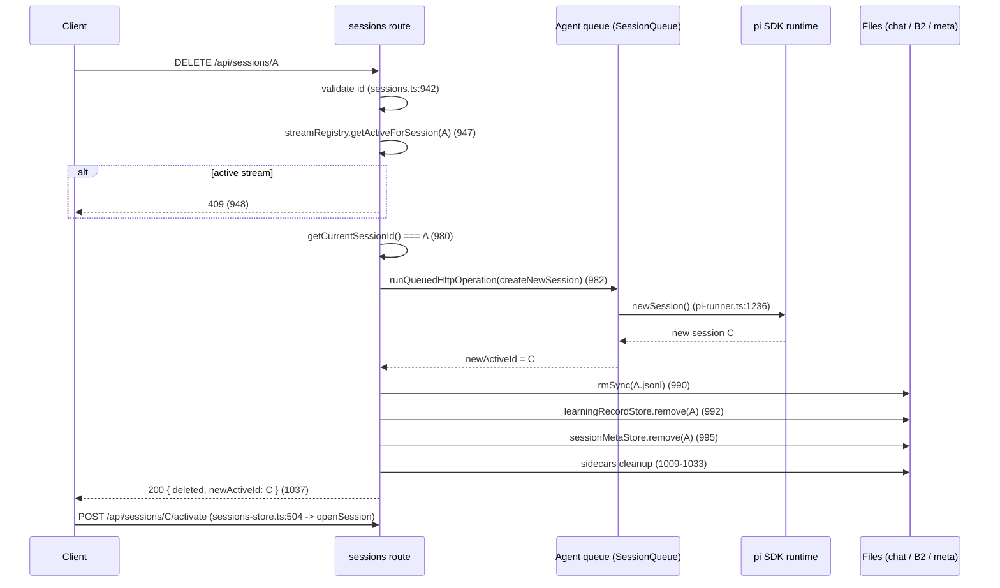

# 会话删除的运行时安全性审计（D3 / D4）

- 仓库：`livepass/My-Learning-Agent`
- 审计基线：`1fae980c5aa500dc7446a022ed889b6947f12a5c`
- 审计日期：2026-11-04
- 范围：删除活动会话时切换已有会话（D3）、删除最后一个会话时解除绑定（D4）
- 约束：审计轮不修改生产代码；只做源码审计、隔离验证与最小修复设计。
- **实施状态（2026-11-04，基线 `7a7a771`）**：D3 与 D4 已按 §6/§7 实施；最终行为、改动清单与验证结果见 §11。§1–§10 保留审计时的原始结论，不再代表当前行为。

**结论摘要**

1. **D3 可以安全实现，但不能在当前删除路径上直接替换**：需要把“切换 + 删除”放进同一个 Agent 队列任务，并补一个删除墓碑（tombstone）。当前实现只要发现删除的是活动会话，就无条件 `createNewSession()`（`sessions.ts:980-983`），不会选择已有 B。
2. **D4 在当前 SDK（`@earendil-works/pi-coding-agent@1.1.0`）上没有受支持的实现**：运行时没有“无会话”状态，`newSession()` 必定创建会话，`dispose()` 是终止性的，不能继续服务。建议返回明确冲突，让用户显式选择。
3. **当前删除路径存在两个已由代码路径确认、但未稳定复现的复活窗口**：并发 `activate`（W2）与已排队 prompt（W4）都可能在删除后重新绑定/重建同名会话文件。D3 修复必须一并处理，否则“切换 B”只会把窗口从“新会话”挪到“B”。

---

## 1. 当前执行时序（删除活动会话 A）



关键点：

- 新会话 C 是**无条件创建**的；即使存在可用的 B，也不会被选中。
- `rmSync(A)` 在队列任务返回之后、且不在队列内（`sessions.ts:990`）。这是所有复活窗口的根源。
- 删除只清理 B2 与 sidecar，L1（`profile.json` / `events.jsonl`）不参与（与 C3 语义一致）。

---

## 2. 三种“会话身份”的所有权

| 身份 | 载体 | 唯一所有者 | 生命周期 |
|---|---|---|---|
| 运行时绑定 | `_runtime.session.sessionFile`（`pi-runner.ts:57`，单例） | `pi-runner.ts`，只允许通过 `SessionQueue`（`session-queue.ts:18`）修改 | 进程内；重启后由 `initSession` 重新创建 |
| 会话文件 | `data/sessions/<id>.jsonl` | SDK `SessionManager`（追加写）；删除由 sessions 路由 | 持久 |
| 会话元数据 | `meta.json` / `channels.json` / `archives.json` / `questions.json` | 各自 sidecar 所有者（`sessionMetaStore`、路由函数） | 持久 |
| B2 学习记录 | `data/learning/<id>.json` | `LearningRecordStore`，按文件 `runExclusive` + writer lock（`record-store.ts:1204`） | 持久 |
| L1 证据 | `data/learner/profile.json` + `events.jsonl` | `profile-store`，删除接口不触碰 | 持久 |

**关键不变量**：运行时绑定不是“外键”。`sessionFile` 只记录路径；把文件删掉不会让运行时自动失联，下一次追加写会**按同一路径重建文件**。因此“删除文件”与“解除绑定”是两件事。

---

## 3. SDK 能力核查

安装版本：`@earendil-works/pi-coding-agent@1.1.0`（`apps/learning-agent/package.json` 声明 `^1.1.0`，`node_modules` 实际 1.1.0）。

| 能力 | 事实 | 证据 |
|---|---|---|
| `newSession()` | **总是创建**一个新的 `SessionManager`；持久化会话创建新的会话文件，内存会话创建内存管理器。没有“保持未绑定”的参数 | `dist/core/agent-session-runtime.js:147-173`（`SessionManager.create` / `inMemory` 在 153-156） |
| `switchSession(path)` | 打开已存在的路径并替换运行时；**不校验文件是否存在** | `agent-session-runtime.js:128-146`；`session-manager.js:1326-1348` 在文件缺失时 `header=null` 但仍构造 manager，`isPersisted=true` |
| 关闭 / 释放 / 解绑 | 只有 `dispose()`：触发 `session_shutdown`、`session.dispose()`，对象终止，不能继续服务 | `agent-session-runtime.js:296-303` |
| 没有 `sessionFile` 时 | SDK 没有这种状态；`SessionManager` 可以是 `inMemory`，但 `AgentSessionRuntime` 始终持有一个 session | 同上；runtime 的 `_session` 是必填构造参数 |
| 项目封装 | 项目封装了 `createNewSession()`（`pi-runner.ts:1232`）与 `switchSessionFile()`（`pi-runner.ts:1164`），**没有**“切换并删除”原语 | 代码审计 |
| 未验证 | `dispose()` 之后在同一进程重新 `initSession()` 是否完全可用 | 未执行；不建议依赖 |

**三分法结论**

- **项目没有封装**：D3 所需的“切换到 B 后删除 A”没有封装，删除路由只调用 `createNewSession`。
- **SDK 确实没有**：D4 所需的“解除绑定且保留可用运行时”没有 API；`newSession` 必建、`dispose` 终止。
- **SDK 可能有但未验证**：`dispose()` + 重新 `initSession()` 能否作为“无会话”方案；本轮不采用。

---

## 4. 并发窗口与证据

### W1 检查“是否活动会话”与入队之间

- `sessions.ts:980` 读取 `getCurrentSessionId()`，`sessions.ts:982` 才入队。两者之间任何 `POST /activate`（`sessions.ts:876-890`）都可以改变运行时。
- 结果：删除可能针对“已经不再是当前会话”的 A 执行 `createNewSession`，多创建一个无意义会话；或反之，删除开始后有人切回 A。
- **证据**：代码路径；未稳定复现（时序窗口取决于事件循环）。

### W2 切换到新会话 C 之后、`rmSync(A)` 之前（复活窗口）

- `sessions.ts:982` 返回后，`sessions.ts:990` 才删文件。中间任何 `POST /activate/A` 都会：
  1. `existsSync(A)` 为 true（`sessions.ts:879`）；
  2. `switchSessionFile(A)` 入队并执行（`pi-runner.ts:1164-1170`）；
  3. 运行时重新绑定 A；
  4. 随后 `rmSync(A)` 把运行时脚下的文件删掉。
- **后果**：下一次 prompt 通过 `switchToSession`（`pi-runner.ts:101-114`）打开缺失路径，SDK 允许（见 §3），写入时重建 `A.jsonl` —— 已删除会话以同一 ID 复活。
- **证据**：代码路径 + SDK 缺失文件不报错的事实；未复现（需要精确插入 `activate`，属于竞态）。

### W3 流式任务的检查与删除之间

- 删除入口检查 `streamRegistry.getActiveForSession`（`sessions.ts:947`），流式路由在 `chat.ts:760` 调 `createTurn` 注册后才入队（`chat.ts:923`）。
- 检查之后、`rmSync` 之前启动的流不会被拒绝：它可能先 `switchToSession(A)`，随后删除把文件删掉，模型输出写回被删路径。
- 反向顺序（删除的队列任务先跑）：流在 A 文件仍存在时切换并开始，删除随后 `rmSync`，同样在写入过程中删文件。
- **证据**：代码路径；未复现（需要毫秒级插入）。
- **注**：`DELETE` 的 409 只在“检查那一刻已注册”时生效，测试 4 覆盖的是这个正常路径。

### W4 已排队的非流式 prompt（复活窗口）

- `chat.ts:544` 先 `existsSync(A)`，`chat.ts:545` 才 `runPromptInSession` 入队；`runPromptInSession` 在队列内 `switchToSession(A)`（`pi-runner.ts:1373-1381`）。
- 删除可以在“存在性检查”与“队列任务执行”之间完成；随后队列任务仍会切到 A 的路径并按需重建文件。
- **证据**：代码路径；未复现。

### W5 队列等待超时与客户端断开

- `runQueuedHttpOperation` 只取消**尚未开始**的任务（`queued-operation.ts:32-46`，`session-queue.ts:34-42`）；`onStarted` 一旦触发，超时与 `close` 都不再中止。
- 对删除的含义：超时返回 409 时，删除一定**没有**开始（`newActiveId` 尚未创建）；一旦开始，即使客户端断开，删除仍会完成并保持存储一致，只是响应可能丢失。
- **证据**：代码 + 现有测试语义；本轮未做断连注入。

### W6 选中的 B 在切换前后被删除

- `SessionManager.open` 不校验文件存在（§3），因此“切换到 B”可能在 B 被删除后仍然成功，运行时绑定到缺失路径。
- 当前代码不涉及 B；D3 必须在队列内重新 `existsSync(B)`，并在删除 B 的路径上使用同一队列/墓碑。
- **证据**：SDK 源码；未复现。

### W7 工作区 cwd

- 切换会话通过 `switchToSession` → `resolveCwdFor`（`pi-runner.ts:88-99`）+ `setWorkspaceCwdResolver`（`server.ts:146-150`）解析 B 的 cwd。
- `createNewSession()` 会把 `_currentCwd` 重置为 `_workspaceDir`（`pi-runner.ts:1246`）。**D3 必须走 `switchSessionFile(B)`，不能复用 `createNewSession`**，否则 B 的工作区不会生效。
- **证据**：代码；未做双工作区实测（当前产品只保留单一 workspace 能力）。

### W8 锁顺序

- 现有顺序：Agent 队列（`pi-runner`）→ B2 每文件队列（`record-store.ts:1204-1220`）。
- `learning` 模块不 import `pi-runner`，没有“持 B2 锁再等 Agent 队列”的路径，因此当前不存在锁反转。
- D3 必须保持这个顺序：**先完成运行时切换/删除文件，再调用 `learningRecordStore.remove`**，不要在 B2 锁内 `await` 队列。
- **证据**：模块依赖与调用点审计。

### 额外观察：删除最后一个会话后的“隐形替代会话”

- 替代会话由 `createNewSession()` 创建（`pi-runner.ts:1232-1250`），没有 channel 元数据，消息数为 0。
- `GET /api/sessions` 的过滤条件要求“有消息 / 显式归档状态 / 当前且 origin=web”（`sessions.ts:698-700`）；新会话的 origin 回退为 `"cli"`（`sessions.ts:281-297`），因此**列表看不到它**，但运行时已经绑定它。
- 已被隔离测试 3 断言（见 §9）：`ids` 不包含 `newActiveId`。
- 这不是 D3/D4 引入的，但 D4 若宣称“没有创建会话”，会与事实冲突。

### 重启行为（与 D4 相关）

- `initSession()` 启动时总是 `SessionManager.create(cwd, paths.sessionDir)`（`pi-runner.ts:324`），即**每次重启都新建一个空会话**，而不是恢复上次活动会话；前端随后通过 `?session=` + `/activate` 把运行时切回视图会话。
- 因此“重启后运行时与持久化会话一致”这一验收项在当前基线**不成立**（视图一致，运行时初始不一致）。D3/D4 不应把这一点当作已解决。

---

## 5. 风险分级

### 已确认（代码 + 测试）

1. **D3 缺失**：删除活动 A 时不会选择 B，而是新建 C。测试 1。
2. **D4 缺失**：删除唯一会话仍会创建替代会话；SDK 无解除绑定能力。测试 3 + SDK 源码。
3. **替代会话对列表不可见**：删除活动会话后，`newActiveId` 指向的会话在 `GET /api/sessions` 中查不到，直到首次发言写入 channel。测试 3 断言。
4. **B2/L1 语义正确**：删除清理 B2 与 sidecar，L1 事件与画像不变（既有 `server.session-archive.test.ts` 已覆盖）。

### 潜在 / 已由代码路径确认，但未稳定复现

5. **W2 复活**：删除活动会话期间 `activate(A)` 可把运行时绑回即将删除的 A，随后被删文件在下次 prompt 时重建。
6. **W4 复活**：已通过存在性检查、尚未执行的 `runPromptInSession(A)` 会在删除后重建 A。
7. **W3 写入中被删**：检查后注册的流式回合可能与 `rmSync` 交错。
8. **W1 多余会话**：检查与入队之间切换会话，导致删除时多创建一个替代会话。

### 尚未验证

9. `dispose()` 后在同一进程重新 `initSession()` 的行为。
10. 双工作区 A/B 切换的 cwd 实测（产品当前未开放多工作区）。
11. 删除期间 B2 写入（finalize）并发时的实际交错；代码上 `runExclusive` 会串行，但没有注入测试。
12. Agent 初始化期间（`ensureAgentReady` 未完成）执行删除的行为。

---

## 6. D3 最小修复方案（本轮不实现）

### 6.1 目标语义

`DELETE /api/sessions/A` 且运行时在 A：

1. 选取真实存在、未归档、非 A 的 B（优先有消息、最近更新；没有则走 D4 分支）。
2. 在**同一个 Agent 队列任务**内：校验 B → `switchToSession(B)` → 确认 `getCurrentSessionId() === B` → 标记 A 为 deleting → 删除 A 文件。
3. 队列任务返回后，再做 B2 / meta / sidecar 清理（保持 Agent→B2 的锁顺序）。
4. 返回 `newActiveId = B`，前端 `openSession(B)`（现有逻辑已按 `newActiveId` 打开）。

### 6.2 建议新增/修改

| 文件 | 变更 |
|---|---|
| `src/agent/pi-runner.ts` | 新增 `replaceSessionAndRemove(oldId, targetPath)`：在 `enqueue` 内完成存在性校验、`switchToSession(targetPath)`、`rm` 旧文件；导出 `isSessionBeingDeleted(id)` 或由路由维护墓碑 |
| `src/server/routes/sessions.ts` | 删除活动会话时先选 B，调用上述原语；在入口设置 `deletingSessions.add(A)`，`finally` 清除；队列内再查一次 `streamRegistry`；失败时不删除 A |
| `src/server/routes/chat.ts` | `/api/chat`、`/api/chat/stream` 在存在性检查前后都拒绝 `deletingSessions` 中的 id（409 `session_deleting`） |
| `web/src/stores/sessions-store.ts` | 仅在响应类型上兼容 `replacedWith`；`deleteSession` 已按 `newActiveId` 打开，无需新逻辑 |

**影响面**：4 个文件；不改 SDK、不改 B2、不新增存储或队列。

### 6.3 失败与边界

- B 在队列执行时消失 → 409 `replacement_unavailable`，A 不删除。
- 切换 B 抛错 → A 不删除，运行时可能仍在 A（保持原状）。
- 队列内流式检查命中 → 409 `session_busy`，A 不删除（此时已切到 B；是否切回 A 需产品决定，建议保持 B 并返回 `switchedTo`，避免二次切换）。
- `rm` 失败 → 500 `session_cleanup_failed`，运行时已在 B、A 文件可能仍在；重试删除应幂等（现有 leftovers 分支可复用）。
- 客户端断开：`onStarted` 后不可取消；删除继续并保持一致（`queued-operation.ts:32-46`）。
- 锁顺序：Agent 队列内只做文件删除，**不**调用 `learningRecordStore.remove`；B2 清理在队列外。

### 6.4 必须补的测试

1. 当前 A + 已有 B：DELETE 后 `newActiveId === B`，A 文件/B2 消失，B 未变。
2. A 流式生成：409，A 与运行时都不变。
3. 并发 `activate(A)` + DELETE：删除完成后 `/activate/A` 必为 404，且不存在同名文件（墓碑生效）。
4. 已排队 prompt（存在性检查通过、尚未执行）+ DELETE：prompt 必须失败（404/409），不得重建 A。
5. B 在队列等待期间被删除：409，A 保留。
6. A 有 C3 证据：删除后 L1 事件不变（复用 `server.session-archive.test.ts` 的模式）。
7. 删除后重启：运行时不再绑定 A；B 可继续对话。

---

## 7. D4 技术可行性结论

**当前 SDK 不支持“真正解除绑定且保持运行时可用”。**

- `newSession()` 必建会话（`agent-session-runtime.js:147-173`）；
- `switchSession()` 必绑定一个路径（`:128-146`），且路径缺失也会成功；
- `dispose()` 终止运行时（`:296-303`），之后 `getSession()` 会抛错（`pi-runner.ts:465`），聊天路由没有“无会话”分支。

因此：

- **禁止** `_runtime = null`：`getSession()`、`runPromptSerialized`、模型设置等都会抛错，且 `ensureAgentReady` 的 promise 已缓存，无法自然重建。
- **禁止**直接删除 `_runtime.session.sessionFile`：这正是 W2/W4 的复活机制。
- **禁止**创建隐形替代会话却宣称没有创建：当前实现就是替代会话，且对列表不可见（§4 额外观察）。

**推荐**：当没有可用 B 时返回明确冲突，让用户选择：

```json
409 {
  "error": "no_replacement_session",
  "message": "这是当前唯一的会话。请先新建一个会话，或归档后继续。",
  "requiresExplicitChoice": true
}
```

前端据此展示“新建会话并删除 / 取消”，只有用户确认后才调用 `POST /api/sessions`，再重试删除。这样既不隐藏创建，也不依赖未支持的解绑。

若未来一定要“无会话”：需要 `dispose()` + 置空 `_runtime` + 懒初始化 + 所有 `getSession()` 调用点的 409 分支，属于跨模块改造，不符合本轮“最小修复”。

---

## 8. 推荐 API 语义

```
DELETE /api/sessions/:id
200 { id, deleted: true, newActiveId: "B.jsonl" | null,
      replacedWith: "existing" | "created" | null }
409 { error: "session_busy" | "no_replacement_session" | "replacement_unavailable",
      ... }
404 { error: "Session not found" }        // 无文件且无残留
500 { error: "session_cleanup_failed", id, deleted: false, retryable: true }
```

- `newActiveId` 保持现有含义（运行时实际绑定），前端无需新分支。
- `replacedWith` 让前端/文档区分“接管 B”与“创建替代”，避免把创建说成未创建。
- 非活动会话删除仍返回 `newActiveId: null`（现状）。
- 归档/恢复 API 不变。

---

## 9. 测试矩阵与执行结果

隔离环境：临时 home、确定性本地 Provider、真实 HTTP、真实文件存储；不使用真实用户数据。
新增审计测试：`apps/learning-agent/src/server.session-delete-audit.test.ts`（5 项，仅断言当前行为）。

| # | 场景 | 方式 | 结果 |
|---|---|---|---|
| 1 | 当前 A、已有 B，删除 A | 自动化 | 通过：`newActiveId` 既不是 A 也不是 B，是新建的 C；A 文件消失，B 保留 |
| 2 | 前端看 B、运行时在 A | 代码审计 | 服务端以 `_runtime` 为准；前端只按 sessionId 发请求，无客户端覆盖路径；未做浏览器实测 |
| 3 | A 正在流式生成 | 自动化 | 通过：DELETE 返回 409，A 文件保留 |
| 4 | A 有占队列的待答问题 | 代码审计 | 删除活动会话前调用 `releaseQueueFromQuestionBlockedTurn("")`（`sessions.ts:981`）；未做队列占用注入 |
| 5 | 删除期间另一请求重新激活 A | 代码审计 | W2：存在窗口；未稳定复现 |
| 6 | 删除期间 B 失效 | 不适用（当前不选择 B） | D3 设计需新增 |
| 7 | Agent 初始化期间删除 A | 未验证 | — |
| 8 | A 的 B2 正在写入 | 代码审计 | 删除在 Agent 队列外调用 `learningRecordStore.remove`，走同一 per-file 队列（`record-store.ts:1204`）；未注入并发 |
| 9 | 只剩 A | 自动化 | 通过：仍创建替代会话；`newActiveId` 不在 `GET /api/sessions` 结果中（观察项） |
| 10 | 删除后重启 | 未执行本轮 | 启动固定新建会话（`pi-runner.ts:324`）；视图由 `/activate` 恢复 |
| 11 | A 已产生 C3 证据 | 既有测试 | `server.session-archive.test.ts`：删除后 L1 事件数与画像不变 |
| 12 | 非法路径/ID | 既有测试 | 归档/删除均 400/404（`server.session-archive.test.ts`） |

自动化结果：

```
npx vitest run apps/learning-agent/src/server.session-delete-audit.test.ts
✓ 5 passed (7.6s)
```

> 这些测试锁定的是**当前基线行为**（例如“删除活动会话会新建 C”），用于证明缺口，不代表期望行为。D3 实施时应替换为“接管 B”的断言。

---

## 10. 是否允许进入正式修复阶段

**D3：允许进入，按 §6 的最小方案实施。** 前提是同时落地墓碑与“切换+删除同一队列任务”，否则只是把 W2/W4 的目标从“新会话”换成“B”。

**D4：不允许按“解除绑定”实施。** SDK 无受支持能力；本轮只建议冲突语义 + 用户显式创建。若要真正的无会话状态，需要单独立项（dispose + 懒初始化 + 全路由分支），不属于 D3/D4 最小修复。

**实施前必须补的验证**：W2/W4 的并发测试（可用可控 Promise 在测试内阻塞 `activate`/prompt，而不是依赖真实时序），以及 B 在队列期间被删除的失败注入。当前审计只证明了顺序路径与代码路径，未把这些竞态变成可重复的测试。

---

## 11. 实施结果（D3 / D4）

### 11.1 实际改动

| 文件 | 变更 |
|---|---|
| `src/agent/session-lifecycle.ts`（新增） | 服务端唯一的删除状态所有者：`beginDeletion` lease、`completeDeletion` tombstone、`abortDeletion` 回滚、`status` / `assertFileUsable`。不新增数据库，不新增第二套 Agent 队列。 |
| `src/agent/pi-runner.ts` | 所有可重绑定会话文件的入口在**队列槽内**调用 `assertFileUsable`：`switchSessionFile`、`runPromptInSession`、`runPromptStreamingInSession`、`branchSessionBeforeUserMessage`、`applyWorkspaceCwd`、`appendAssistantNotificationInSession`；`persistPendingUserTurn` 拒绝把墓碑会话刷回磁盘。新增 `replaceActiveSessionAndRemove`：同一队列槽内复核 B、切换、确认绑定、删除 A。 |
| `src/server/session-replacement.ts`（新增） | 纯选择器：排除 A、已删除/删除中、已归档、无法解析、零消息的候选；按 `updatedAt` 倒序取第一条。零消息会话不因“曾经恢复”而成为替代。 |
| `src/server/routes/sessions.ts` | DELETE 改为 lease 保护 + D3 接管 + D4 409；删除 A 的聊天文件在队列内，B2/meta/sidecar 清理在队列外；activate/branch 增加删除状态与队列错误映射；响应增加 `replacedWith`。 |
| `src/server/routes/chat.ts` | 显式 `sessionId` 先查删除状态与文件：删除中 409 `session_deleting`，已删除/不存在 404；删除 `runPromptSerialized()` 回退；队列内 guard 抛出的 `SessionUnavailableError` 映射为 409/404。流式入口同样先拒绝删除中的会话。 |
| `web/src/api/sessions.ts` | `DeleteSessionResult` 增加可选 `replacedWith`。 |
| `web/src/react/pages/LearnPage.tsx` | 删除确认不再宣称“服务端会创建新会话”；`no_replacement_session` / `replacement_unavailable` / `session_deleting` 翻译为可操作提示，不自动重试。 |
| `web/src/stores/sessions-store.ts` | 无需改逻辑：现有实现只在服务端成功后才移除列表项，并按 `newActiveId` 打开接管会话；本轮用测试锁定该行为。 |

### 11.2 删除活动会话 A 的最终时序

```mermaid
sequenceDiagram
    participant C as Client
    participant R as sessions route
    participant L as sessionLifecycle
    participant Q as Agent queue
    participant S as pi runtime
    participant FS as Files

    C->>R: DELETE /api/sessions/A
    R->>R: validate id / active stream check
    R->>L: beginDeletion(A)  (lease)
    R->>R: selectReplacementSession(exclude A)
    alt no eligible B
        R-->>C: 409 no_replacement_session
        Note over R,L: finally abortDeletion(A); nothing removed
    else B found
        R->>Q: replaceActiveSessionAndRemove(A, B)  [enqueue]
        Q->>L: assertFileUsable(B) + route validate(B)
        Q->>S: switchToSession(B)
        Q->>Q: verify getCurrentSessionId() === B
        Q->>FS: rm A.jsonl
        Q-->>R: { newActiveId: B }
        R->>L: completeDeletion(A)  (tombstone)
        R->>FS: B2 remove(A) / meta remove(A) / sidecars
        R-->>C: 200 { newActiveId: B, replacedWith: "existing" }
    end
```

关键点：`rm A` 与 `switch B` 共享队列槽；HTTP 层先拿 lease 再入队，因此排队期间新的 `activate(A)`、`chat(A)`、`chat/stream(A)` 都被 409 拒绝。队列任务执行前再次确认 B 与 A 的权威状态，避免把运行时绑到已失效的 B。

### 11.3 队列内重新校验矩阵

| 入口 | 队列内检查 | 失败语义 |
|---|---|---|
| `switchSessionFile` | 文件存在 + 非 deleting/deleted | `SessionUnavailableError` → activate 409/404 |
| `runPromptInSession` | 同上 | 显式 chat 404/409；不回退 |
| `runPromptStreamingInSession` | 同上 | SSE 回合以 error/aborted 结束，不写 A |
| `branchSessionBeforeUserMessage` | 同上 | 409/404 |
| `applyWorkspaceCwd` | 存在 + 非 blocked；否则跳过 | 不绑定缺失路径 |
| `appendAssistantNotificationInSession` | 同上 | 拒绝，不重建文件 |
| `persistPendingUserTurn` | 当前运行时会话非 blocked | 返回 false，不刷盘 |
| C1/C2/C3 学习写路由 | `sessionExists` 回调增加 lifecycle 检查 | 删除中/已删除返回 404，不新写 B2 |

### 11.4 最终 API 语义

```
DELETE /api/sessions/:id
200 { id, deleted: true, newActiveId: "B.jsonl" | "C.jsonl" | null,
      replacedWith: "existing" | null }
409 { error: "no_replacement_session", requiresExplicitChoice: true }
409 { error: "replacement_unavailable", retryable: true }
409 { error: "session_deleting", id }
409 { error: "session_busy", blocking? }
404 { error: "Session not found" }
500 { error: "session_cleanup_failed" | "session_switch_failed", deleted: false, retryable: true }
```

- 活动 A + 合格 B：`newActiveId = B`，`replacedWith = "existing"`。
- 活动 A + 无合格 B：409，A/B2/L1 不变，不创建任何会话。
- 非活动 A：`newActiveId = null`，运行时不动。
- 运行中被其他请求切走：只删除 A，`newActiveId` 为实际绑定（不回抢）。

### 11.5 失败注入与并发测试

新增 `src/server/routes/session-delete-races.test.ts`（8 项）用可控 `Promise` barrier 注入真实异步边界：

1. 删除任务已入队但被 gate 阻塞时，`POST /api/sessions/A/activate` 返回 409 `session_deleting`，`switchSessionFile` 从未调用。
2. 同一窗口内 `POST /api/chat { sessionId: A }` 返回 409，`runPromptInSession` / `runPromptSerialized` 均未调用（既不写 A，也不误写 B）。
3. gate 放行后 A 被删除、B 接管；lease 清除后再次 activate A 为 404，`switchSessionFile` 仍未调用（tombstone 生效）。
4. 无合格 B：409 `no_replacement_session`，`replaceActiveSessionAndRemove` 与 `createNewSession` 均未调用，A 保留。
5. B 在队列中失效：409 `replacement_unavailable`，A 保留，lease 回滚（可再次删除）。
6. 队列超时：409 `session_busy`，A 保留，lease 回滚。
7. 切换抛错：500 `session_switch_failed`，A 保留，lease 回滚。
8. B2 清理 `learningRecordStore.remove` 在运行时交接任务仍持队列槽时不会被调用；放行后才执行，保持 Agent → B2 顺序。

新增 `src/session-delete-runtime.test.ts`（7 项）直接驱动真实 `pi-runner` + 假 runtime：

1. 已通过 HTTP 存在性检查、正在队列等待的 `runPromptInSession(A)`，在 A 被删除 + tombstone 后失败，A 未被重建。
2. `switchSessionFile` / `branchSessionBeforeUserMessage` / `appendAssistantNotificationInSession` / `runPromptStreamingInSession` 对已删除 A 全部拒绝，`switchSession` 零调用。
3. `replaceActiveSessionAndRemove` 在同一个队列槽内切换 B 并删除 A。
4. B 在任务执行前消失 → 拒绝，A 保留，运行时不动。
5. 路由级 `validate` 判定 B 不合格 → 拒绝，A/B 都保留。
6. 运行时在任务执行前被切到 C → 只删除 A，返回实际绑定 C，不调用 switch。
7. 切换后绑定校验失败 → 抛错且 A 保留（不凭未验证的切换删文件）。

新增 `src/server/session-replacement.test.ts`（3 项）：最近可见会话优先；空白/归档/blocked 全部排除；目录缺失返回 null。

### 11.6 HTTP 集成验证

`src/server.session-delete-audit.test.ts` 已从“锁定旧行为”改写为 D3/D4 行为（8 项，真实服务进程 + 真实会话文件 + 真实 B2/L1 + 确定性 Provider）：

| 场景 | 结果 |
|---|---|
| A 活动、已有有消息的 B | 200，`newActiveId = B`，A 文件消失，B 字节不变，无新会话 |
| A 活动、仅有隐藏空白会话 | 409 `no_replacement_session`，文件列表与 A 字节不变 |
| 只有 A | 409，A/B2/L1 全不变，无新文件；用户显式新建 B 后再次删除 A 成功（非活动删除） |
| 删除非活动会话 | 200，`newActiveId = null`，运行时仍在 A（后续无 sessionId 的消息落到 A） |
| 显式向已删除 A 发非流式/流式消息 | 404；B 字节完全不变；不出现回退写入 |
| A 正在流式生成 | 409，A 文件保留 |
| A 有 C3 证据 | A 的 B2 删除、学习接口 404、L1 画像与事件逐字节不变、证据数不变 |
| 删除完成后重启 | A 仍 404、文件不复活；B 可 activate 并继续对话 |

### 11.7 与审计方案的差异

1. **非活动删除也使用 lease/tombstone**：审计只要求活动删除加墓碑；实施时统一处理，避免“已排队的非活动 A 任务在删除后重建文件”。
2. **B 的复核通过 `validate` 回调在队列内完成**：除文件存在与 lifecycle 外，还重新读取 `archives.json`，避免排队期间 B 被归档后仍被接管。
3. **运行时被并发切走时不强制切换 B**：任务只删除 A，并返回实际绑定 id；避免删除请求把用户从新导航的会话拖走。`replacedWith` 仍表示“没有创建替代会话”。
4. **D4 不再进入 `createNewSession` 分支**：审计的 409 建议原样落地；前端不自动二次 DELETE，也不自动创建。
5. **`persistPendingUserTurn` 增加墓碑检查**：审计未列，但它是流式 finalize 写回磁盘的最后一道口子。

### 11.8 仍未验证

- 真实浏览器双标签并发（删除 A 的同时在另一标签 activate A）只由路由级 barrier 测试覆盖，未做 Chrome 真机截图。
- `dispose()` 后重建运行时（真正无会话）仍未验证；D4 明确不采用该路线。
- Agent 初始化期间删除只做了代码路径分析（`initSession` 必建新会话，不会绑定 A），未注入慢初始化。
- “B2 finalize 正在写入同一会话时删除”未做真实并发注入；删除的 B2 清理仍走 `LearningRecordStore.remove` 的每文件队列，锁顺序未改。
- 未做切换/删除中途 `SIGKILL`；重启测试验证的是删除完成后的持久状态。
