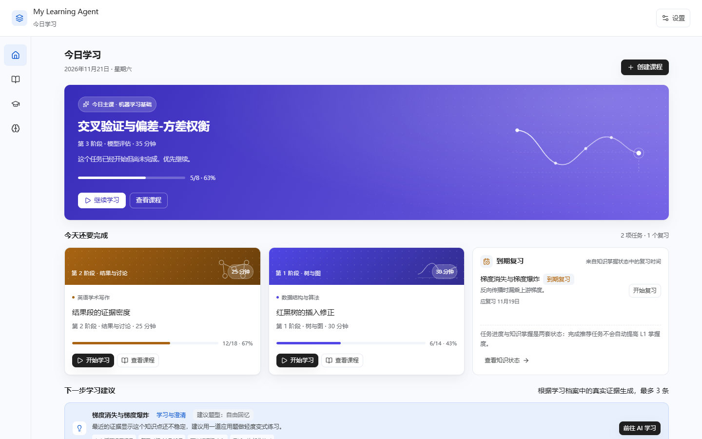
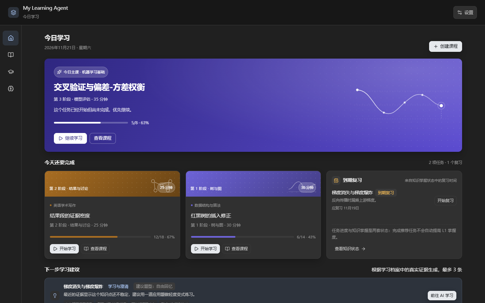
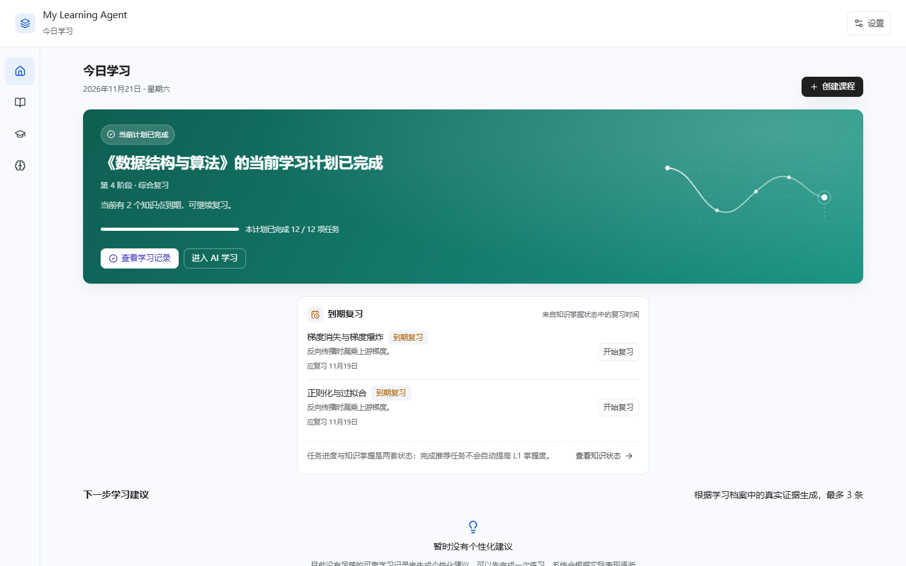
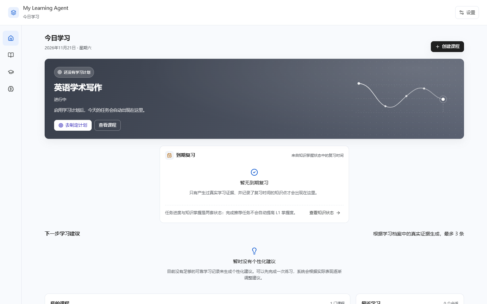
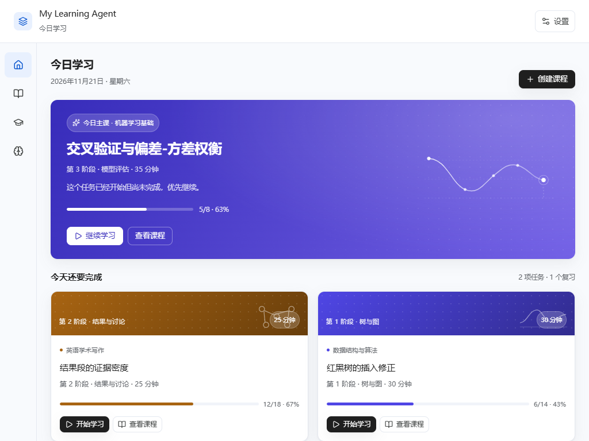
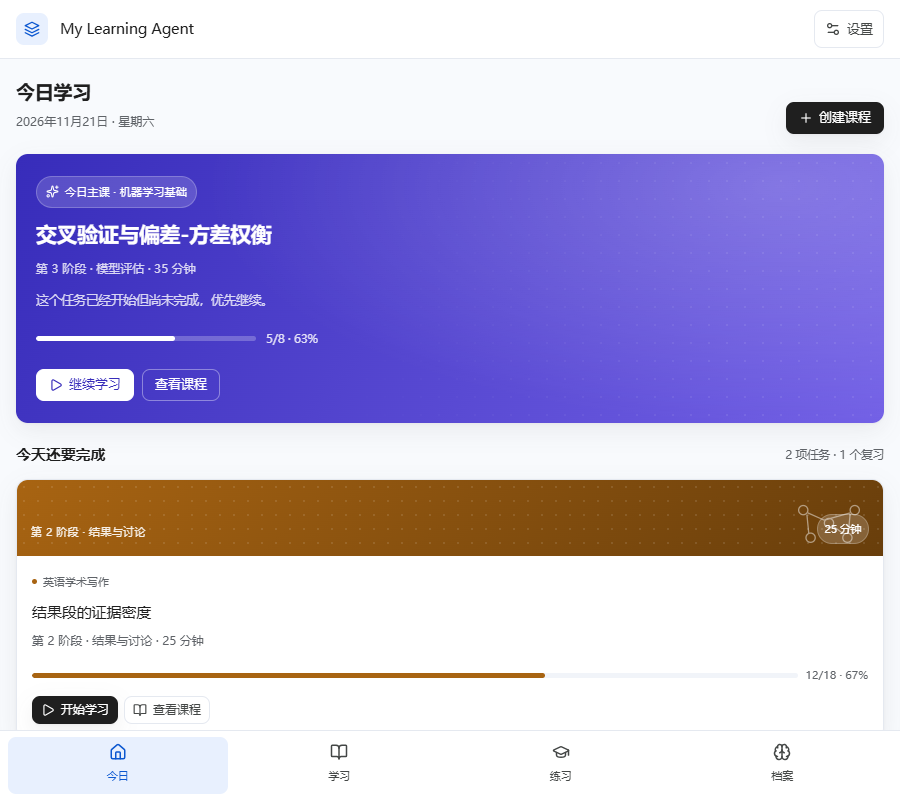
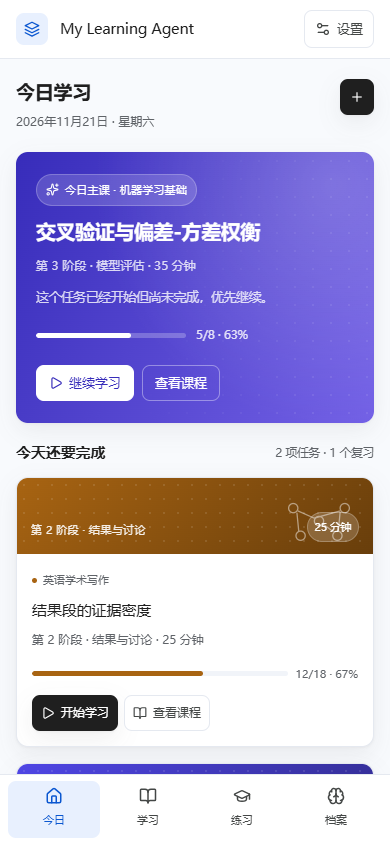
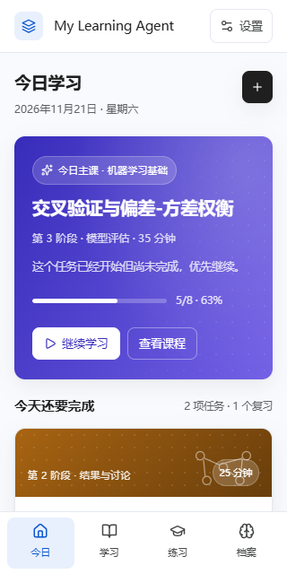
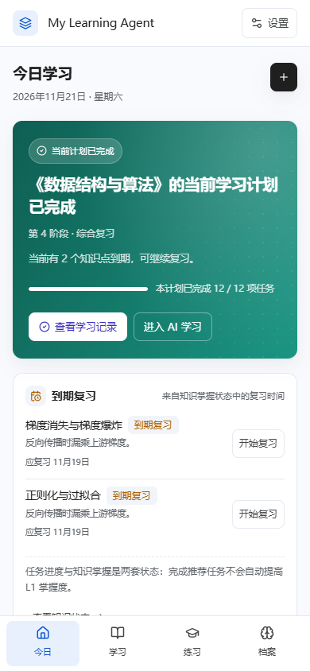
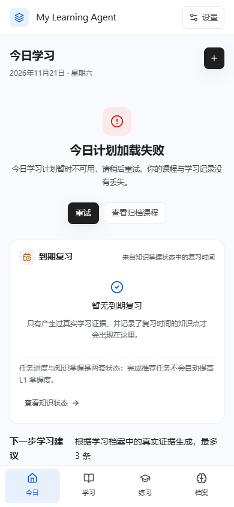

# E4.9f-R1 今日学习 UI 集成修复与验收

- **基准提交**：`f3f54cca080504ff53d380be9eb299ebd90e9028`（`main`）
- **执行分支**：`fix/e49f-r1-today-ui`
- **修复前分支 HEAD**：`0703bb6398647bb68a0db9e83886eebfa073424d`
- **代码修复提交**：`c440d22fe9a3f47de0f74be13ab93e3894aa8fef`
- **验收报告与截图**：随本文件所在提交进入同一 PR；PR HEAD 以远端分支为准
- **结论**：**PASS**（满足合并条件，等待人工审查；未直接合并 `main`）

---

## 1. 执行前的仓库状态

| 检查项 | 结果 |
| --- | --- |
| 本地 `main` | `f3f54cc`，与 `origin/main` 一致 |
| 远程修复分支 | `origin/fix/e49f-r1-today-ui`，HEAD `0703bb6`，与任务给定值一致 |
| 工作区 | 切换前无未提交修改，未覆盖他人改动 |
| 分支差异 | 修复前仅有 `TodayPage.tsx` 的 28 行新增 / 13 行删除；`TodayHero.tsx` 未同步 |
| 本地服务 | 验收时用临时数据目录启动 `127.0.0.1:3100`，未触碰真实用户数据 |

修复前的类型检查已复现接口不匹配：

```text
src/react/pages/TodayPage.tsx(318,7): error TS2322:
Property 'disabled' does not exist on type
'IntrinsicAttributes & { variant: TodayHeroVariant; ... }'
```

同时 `TodayHero` 仍要求 `doneCount`、`courseCount`、`totalMinutes`，而 `TodayPage` 已删除这三个传参。

---

## 2. 原始问题与证据

### P0-1 — `TodayHero` 接口不一致

`TodayPage` 已改为传 `disabled`，`TodayHero` 的 props 里没有该字段；三个旧计数参数已从调用方删除，但组件仍声明为必填。TypeScript 直接失败，页面无法构建。

### P0-2 — 完成态被错误推断

修复前的判断是：

```ts
const allTasks = taskRefs.map((ref) => ref.item);
const done = allTasks.length > 0 && allTasks.every((task) => task.status === "completed");
```

后端 `apps/learning-agent/src/courses/daily-plan.ts` 在生成每日任务时已经过滤 `status === "completed"`：

```ts
.filter((task) => task.status !== "completed")
```

因此 `items` 中永远不会有已完成任务。这个判断实际上不会成立；更危险的是，任何“空任务数组 + 其他条件”都可能被误判为完成。真正的完成信号是服务端字段 `daily.status === "all_completed"`，进度是 `daily.task_progress`。

### P0-3 — 暂停课程可能抢占主课

修复前的主课选择只按 `updated_at` 排序。用户修改一门已暂停课程的标题或描述，会让它排到最前，首页 banner 从“可执行任务”变成“课程已暂停”。

### P1-1 — 写操作并发与失败归因

- 课程行的归档 / 删除菜单没有接入 `pendingAction`，开始学习期间仍可点。
- `lastAttempt` 在一次失败后不会被清除；之后任意其他写操作失败，都会被错误显示成“没能建立学习会话”。
- 主课与任务卡的开始按钮虽然传了 `disabled`，但 `TodayHero` 未消费，实际仍可点击。

### P1-2 — 状态文案与视觉细节

- 每日计划失败复用了“课程数据暂时不可用”，把计划故障说成了课程故障。
- “有启用计划但没有任务”（`empty_plan`）与“计划已完成”（`all_completed`）没有区分。
- 任务区使用 `auto-fit`，1440px 下计算出 4 条轨道，出现空列。
- 移动端主要操作按钮沿用桌面 28px 高度，触控目标偏小。

---

## 3. 修改文件清单

| 文件 | 改动 |
| --- | --- |
| `apps/learning-agent/web/src/react/pages/TodayHero.tsx` | 新增 `disabled`；删除 `doneCount` / `courseCount` / `totalMinutes`；完成态改读 `task_progress`；新增 `empty-plan` 分支；开始 / 恢复按钮使用 `busy \|\| disabled` |
| `apps/learning-agent/web/src/react/pages/TodayPage.tsx` | 改用纯函数选主课；完成态只认 `all_completed`；新增 `empty_plan` 分支；修复 `lastAttempt` 生命周期；计划错误专属文案；课程菜单接入 `anyWrite` |
| `apps/learning-agent/web/src/react/pages/today-primary-course.ts` | **新增**：可测试的主课优先级纯函数 |
| `apps/learning-agent/web/src/react/pages/TodayPanels.tsx` | `TodayCourses` 接收 `disabled`；`TodayError` 挂载时聚焦并可被读屏定位 |
| `apps/learning-agent/web/src/react/courses/CourseRow.tsx` | 菜单触发器、归档、删除在写操作期间禁用 |
| `apps/learning-agent/web/src/react/shell/shell.css` | 任务区恢复 3 / 2 / 1 列；≤1100px 复习卡跨两列；移动端文字按钮 ≥36px；错误面板不绘制整块焦点框 |
| `apps/learning-agent/web/src/i18n/locales/zh-CN.json` | 完成态、空计划、计划错误新文案；删除“明天会自动生成”表述 |
| `apps/learning-agent/web/src/i18n/locales/en.json` | 与中文同键、同插值参数 |
| `apps/learning-agent/web/src/react/pages/TodayPage.courses.test.tsx` | 新增 T01–T16（含 T07b、T16b），共 27 项 |

未修改：后端业务规则、每日计划生成逻辑、L1/L2/L3、复习资格与掌握度算法、API 契约、路由与 stores、`AppShell`。

---

## 4. 各问题的修复方式

### 4.1 TodayHero 接口（R1-1）

```ts
// TodayHero props
task?: DailyTask;
busy: boolean;
disabled: boolean;
reviewCount: number;
```

- 主课“开始 / 继续学习”和暂停课程“继续课程”均为 `disabled={busy || disabled}`。
- 保留原有 `Loader2` spinner、按钮文案和 `mla-today-hero-cta` 样式。
- 删除三个旧计数参数；调用方与类型定义已一致。

### 4.2 完成态（R1-2）

```ts
const planCompleted = primaryDaily?.status === "all_completed";
```

- 完成标题：`《{{title}}》的当前学习计划已完成`。
- 进度：直接读 `daily.task_progress.completed / total`，不再用 `items.length` 或任何前端推导。
- 有到期复习：`当前有 N 个知识点到期，可继续复习。`
- 无到期复习：`当前计划的任务已完成，可以进入课程安排下一阶段。`
- 删除“明天会按学习计划生成新的任务”——后端没有承诺每天自动生成。
- `empty_plan` 单独显示“计划中没有任务”，提供“查看课程计划”。

完成态仍保留复习入口，且文案明确“任务进度与知识掌握是两套状态”，不把任务完成说成知识已掌握。

### 4.3 主课优先级（R1-3）

新增纯函数 `selectPrimaryCourse`：

| 层级 | 条件 |
| --- | --- |
| 1 | `in_progress` 课程，且当前任务 `status === "in_progress"` 或 `reason_code === "in_progress"` |
| 2 | `in_progress` 课程，且有下一项可执行任务 |
| 3 | `in_progress` 课程，但今天没有任务 |
| 4 | 暂停 / 已完成课程 |

同一层级内按 `updated_at` 倒序；`Array.prototype.sort` 稳定，结果确定。归档课程在函数入口过滤。函数不生成任务、不改课程状态。

### 4.4 写操作并发与失败归因（R1-4）

- `pendingAction` 已有的幂等机制保持不动：`startLearning` 的 request id 按 `(courseId, taskId)` 复用，成功后才删除。
- 页面层统一 `anyWrite = Boolean(pendingAction)`：
  - 主课开始 / 恢复：`busy || disabled`
  - 任务卡开始：`busy || disabled`
  - 顶栏创建课程：`disabled={anyWrite}`
  - 课程行菜单触发器、归档、删除：`disabled={anyWrite}`
  - 删除确认对话框：沿用自身 `busy`（`delete_course` / `archive_course` 等）
- 双击开始：Store 的 `pendingAction` 在第一次调用时同步置位，第二次调用直接返回 `null`，不会发第二个请求；测试断言只调用一次。
- 成功后必须拿到 `result.session.session_id` 才 `navigate("learn", ...)`。
- 失败不创建会话、不跳转，保留 `lastAttempt` 供重试。
- 重试复用原 `courseId` / `taskId`，request id 也保持一致（测试断言）。
- `lastAttempt` 生命周期：
  - 开始失败 → 保留，显示“重试”；
  - 开始成功 → 清空；
  - 恢复、创建、归档、删除、打开创建对话框 → 先清空；
  - 因此其他写操作失败只显示“操作未完成”，不会误报“没能建立学习会话”。

### 4.5 状态与文案（R1-5）

| 状态 | 展示 |
| --- | --- |
| 课程列表加载中 | 骨架屏 |
| 每日计划加载中 | 骨架屏 |
| 课程列表失败 | “课程加载失败” + 重试 + 查看归档 |
| 每日计划单独失败 | “今日计划加载失败” + 计划专属说明 + 重试 |
| 没有课程 | 三步引导 + 创建入口 |
| 全部归档 | 归档说明 + 查看归档课程 |
| 课程暂停 | 暂停横幅 + 继续课程，不显示开始学习 |
| 无启用计划 | “还没有学习计划” + 去制定计划 |
| 启用计划无任务 | “计划中没有任务” + 查看课程计划 |
| 学习会话启动失败 | `role="alert"`，自动聚焦，保留重试 |

`TodayError` 在挂载时 `focus({ preventScroll: true })`，键盘用户不需要从页首寻找；重试按钮保留自己的焦点环。

---

## 5. 自动化测试

### 5.1 新增覆盖

`apps/learning-agent/web/src/react/pages/TodayPage.courses.test.tsx` 共 **27 项通过**。

| 编号 | 场景 | 结果 |
| --- | --- | --- |
| T01 | 最近更新的暂停课程 vs 有任务的进行中课程 | 主课展示有任务的课程 |
| T02 | A 有进行中任务，B 有待开始任务 | A 优先 |
| T03 | 两门课程都有待开始任务 | 按 `updated_at` 稳定选择 |
| T04 | `all_completed` | 展示计划完成态与 12 / 12 |
| T05 | 任务为空但计划未完成 | 不显示完成态 |
| T06 | 计划完成且有到期复习 | 复习入口保留 |
| T07 | 无启用计划 | 显示去制定计划 |
| T07b | `empty_plan` | 显示计划中没有任务，不误报完成 |
| T08 | 课程暂停 | 显示继续课程，不显示开始学习（既有用例） |
| T09 | 开始请求未返回 | 所有开始按钮禁用；双击只发一次请求 |
| T10 | 返回有效会话 | 成功后才导航（既有用例） |
| T11 | 开始失败 | 留在本页、显示错误并聚焦（既有用例扩展） |
| T12 | 失败后重试 | 原课程、任务、request id 不变 |
| T13 | 其他写操作失败 | 不误显示学习会话失败 |
| T14 | 全部归档 | 进入归档中心（既有用例） |
| T15 | 课程成功、每日计划失败 | 计划错误 + 重试；文案为计划专属 |
| T16 | 中英文切换 | 完成态就地切换 |
| T16b | 中英文切换 | 计划错误文案就地切换 |

测试不依赖执行顺序；每个用例独立 mock，`beforeEach` 重置 store 与语言。

### 5.2 命令与结果

| 命令 | 结果 |
| --- | --- |
| `npx tsc -p tsconfig.json --noEmit`（`apps/learning-agent/web`） | 通过，0 错误 |
| `npm test -- apps/learning-agent/web/src/react/pages/TodayPage.courses.test.tsx` | 1 个文件，27 项通过 |
| `npm --workspace my-learning-agent-web run build` | 通过 |
| `npm run build` | 通过（后端 + 前端） |
| `npm test` | **182 个文件通过，1935 项通过，3 项跳过，0 失败** |

**关于 `npm ci`**：工作区已安装依赖，`node_modules` 完整，未重复执行 `npm ci`，避免在验收环境重复下载；所有命令直接基于现有锁文件依赖运行。若 CI 需要，可按仓库标准流程执行。

**3 项跳过**均为环境条件守卫，不是失败：

- `memory/l3/l3.test.ts`：当前 Node 运行时没有 `node:sqlite` FTS5；
- `server/static-serve.test.ts`：文件系统不支持符号链接；
- `storage/file-store.test.ts`：Windows 上跳过 0o600 权限断言。

与 `main` 对照：本轮未引入新的失败；`main` 上该测试文件为 13 项，本分支为 27 项（新增 14 项），全量 1935 通过 / 0 失败。3 项跳过与 `main` 的环境守卫一致。

---

## 6. 浏览器视觉验收

### 6.1 方法

- 使用实际构建产物：`npm --workspace my-learning-agent-web run build` 后，由本地服务托管 `apps/learning-agent/web/dist`。
- 服务使用临时数据目录（`.tmp/e49f-r1`），不读写真实用户数据。
- 课程与每日计划通过 Playwright 路由注入受控测试数据；学习者档案、会话列表等仍走真实服务。
- 截图对象是真实 React 页面，**不是** `docs/ui-redesign/phase2/prototype.html`。
- 每个视口记录：横向溢出、任务区列数、标题与操作区重叠、菜单是否在视口内、底部导航是否遮挡、移动端小目标数量、键盘焦点、CLS。

脚本：`.tmp/pw/e49f-acceptance.js`；原始指标：`docs/ui-redesign/E4.9f-R1-assets/metrics.json`（未提交 `.tmp`）。

### 6.2 截图

**桌面默认态（1440 × 900）**



**桌面深色主题（1440 × 900）**



**桌面计划完成态（1440 × 900）**



**桌面无启用计划（1440 × 900）**



**窄屏桌面（1024 × 768）**



**导航边界（900 × 800）**



**手机默认态（390 × 844）**



**最窄手机（320 × 640）**



**手机完成态（390 × 844）**



**手机每日计划失败（390 × 844）**



### 6.3 检查结论

| 视口 | 任务列 | 横向溢出 | 标题 / 操作重叠 | 课程菜单 | 底部导航遮挡 | 小目标（<32px） | 结论 |
| --- | --- | --- | --- | --- | --- | --- | --- |
| 1440 | 3 | 0 | 无 | 在视口内 | 无（桌面无底栏） | 9（桌面 28px 控件） | 通过 |
| 1024 | 2 | 0 | 无 | 在视口内 | 无 | 9（桌面控件） | 通过 |
| 900 | 1 | 0 | 无 | 在视口内 | 无（内容底 710 < 导航顶 730） | 9（桌面控件） | 通过 |
| 390 | 1 | 0 | 无 | 在视口内 | 无（内容底 754 < 导航顶 774） | 0 | 通过 |
| 320 | 1 | 0 | 无 | 在视口内 | 无（内容底 550 < 导航顶 570） | 0 | 通过 |
| 390 错误态 | — | 0 | — | 在视口内 | 无 | 0 | 通过 |

- **主课横幅**：标题、徽标、理由、进度、按钮纵向排列，均无重叠；`title.right` 始终在 banner 内。
- **任务换列**：1440 三列 → 1024 两列（复习卡跨两列）→ 900 及以下单列。
- **复习入口**：完成态、无计划态、默认态均可点击；失败态下复习卡仍独立可用。
- **课程菜单**：所有视口 `menuInsideViewport === true`，未被裁切。
- **底部导航**：900 / 390 / 320 滚动到底部后，内容底边均高于导航顶边。
- **深色主题**：主课 banner、任务卡封面、复习卡、按钮对比度经目视检查可读；未出现过暗文字。
- **键盘焦点**：首个 Tab 为“跳到主要内容”，2px solid 可见轮廓；后续按钮聚焦时同样显示 2px 轮廓或 ring；错误态挂载后焦点落在错误面板，下一次 Tab 到“重试”。
- **移动端触控**：390 / 320 下所有可见文字按钮 ≥36px，小目标数量为 0；课程菜单图标为 32×32。

**CLS（首次加载）**

| 状态 | CLS |
| --- | --- |
| 桌面默认 / 1024 / 900 / 390 / 320 | 0.00 |
| 桌面深色 | 0.0255 |
| 桌面完成 | 0.0746 |
| 桌面无计划 | 0.1856 |
| 手机错误 | 0.3883 |
| 手机完成 | 0.3317 |

说明：默认路径 CLS 为 0；终态（完成 / 无计划 / 错误）从通用骨架切换到高度更短的终态时会有一次高度变化，属于加载占位的固有差异，不是加载完成后的持续抖动。此项列为残余风险，不影响本轮合并条件。

**控制台**

- 默认、深色、完成、无计划、1024、900、390、320：0 个 JS 错误。
- 手机错误态：仅 1 条由受控 503 触发的资源加载错误（预期），无 `pageerror`。

---

## 7. 未解决问题与风险

1. **保留 64px 桌面图标栏，未重建 248px 文字侧栏。** 这是刻意的范围控制：改导航会同时影响 AI 学习、练习、档案、设置四个页面。今日页所需的课程、目标、最近学习已在主区面板中。若需要完整还原方案 B 的侧栏，应单独做一次导航改造。
2. **终态 CLS。** 完成 / 无计划 / 错误态在首次加载时从骨架切到更短内容，CLS 最高 0.39；默认路径为 0。可后续通过“按状态预估骨架高度”或“局部骨架”降低。
3. **桌面控件高度 28px。** 移动端文字按钮已提升到 36px；桌面仍沿用设计系统的 28px。若要求所有端达到 44px，需要全局调整 `Button` 尺寸，不在本轮范围。
4. **课程归档 / 删除仍在课程行菜单中。** 与方案 B 规格一致，菜单在悬停 / 聚焦时提亮，且写操作期间整体禁用；没有把破坏性操作放到首屏。
5. **`empty_plan` 没有单独截图。** 已由 T07b 覆盖文案与跳转；视觉上与“无启用计划”共用 quiet banner，仅徽标与 CTA 不同。
6. **浏览器验收使用受控 API 数据。** 这是为了稳定复现完成 / 无计划 / 错误态；真实服务只提供空档案与会话。启动失败的真实网络路径由单元测试覆盖，未做真实后端 E2E。

---

## 8. 是否满足合并条件

| 条件 | 结果 |
| --- | --- |
| TypeScript 编译通过 | 是 |
| 完整构建通过 | 是 |
| 相关自动化测试通过 | 是（27 项今日页测试） |
| 没有新增回归失败 | 是（全量 1935 通过 / 0 失败） |
| 完成态使用服务端可信字段 | 是（`all_completed` + `task_progress`） |
| 主课优先展示可执行任务 | 是（四级优先级 + 纯函数测试） |
| 学习会话启动与重试安全 | 是（request id 复用、成功后导航、失败不建会话） |
| 中英文文案一致 | 是（同键、同插值参数，T16 / T16b） |
| 响应式视觉验收完成 | 是（1440 / 1024 / 900 / 390 / 320 + 深浅主题） |
| 提供完整验收报告及 PR | 是（本文件 + PR） |

**结论：PASS。** 未发现需要修改后端业务规则、API 契约或其他页面的阻塞项；未直接合并 `main`，等待人工审查。

---

## 9. 下一阶段 UI 改造建议

1. **导航层单独改造**：在今日页稳定后，单独评估 248px 文字侧栏对四个页面的影响，避免和内容层改动混在一起。
2. **骨架按状态收敛**：为完成 / 无计划 / 错误态提供不同高度的骨架，或只骨架化主课区，降低终态 CLS。
3. **视觉回归进 CI**：把本目录的 10 张截图与 `metrics.json` 作为基线，用 Playwright 做 5 个断点 + 深浅主题的截图对比。
4. **真实后端 E2E**：补一条“开始学习失败 → 重试 → 成功进入会话”的端到端用例，覆盖真实 `learning/start` 与 session 绑定。
5. **移动端触控规范**：若产品要求 44px，统一调整 `Button` 的移动端尺寸，而不是只在今日页打补丁。
