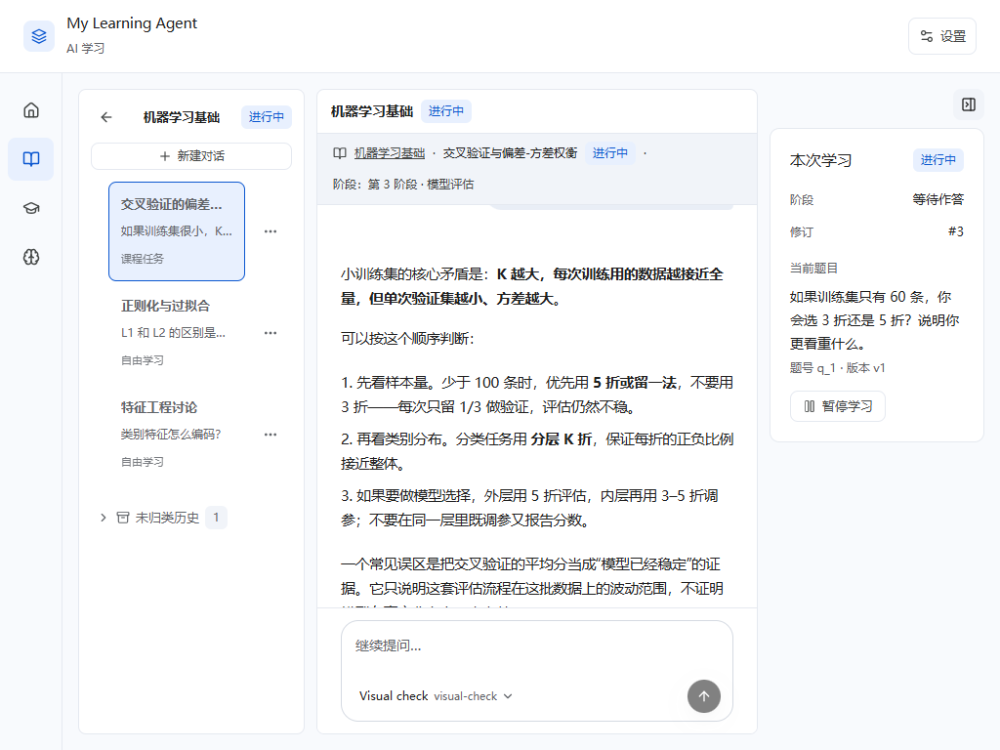
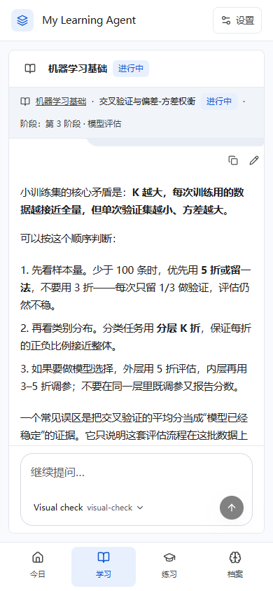

# E4.9g-P1 现状分析：AI 学习页

- **基准提交**：`1f324efef5110c0e9bdad86e7af9756ebd2622ff`（`main`）
- **分析范围**：`apps/learning-agent/web/src` 的 AI 学习页及其直接依赖
- **本阶段**：只做分析、方案与原型；未修改任何业务代码
- **方法**：阅读组件、Store、API、i18n 与测试；启动真实构建产物，用受控接口数据测量 1440 / 1024 / 390 三档布局

---

## 1. 现有页面结构

```text
AppShell
├─ 顶部栏：品牌 + 当前页名 + 设置
├─ 桌面 64px 图标栏 / <900px 底部导航
└─ main.mla-main--flush（沉浸式，无页面内边距）
   └─ LearnPage
      ├─ 欢迎态（currentSessionId === null）
      │  ├─ 720–760px 居中列
      │  ├─ 问候语 + 课程状态
      │  ├─ 快捷开始（讲解 / 练习 / 复习）或课程选择卡
      │  ├─ 「继续之前的对话 · N」折叠历史
      │  ├─ 切换课程 / 未归类历史 / 查看归档
      │  └─ composer（未选课程时禁用）
      └─ 会话态（currentSessionId !== null）
         ├─ 左栏 260px：课程标题 + 新建对话 + 本课会话 + 未归类历史 + 归档入口
         ├─ 中栏 1fr：聊天卡
         │  ├─ 会话头：课程标题 + 状态徽标
         │  ├─ CourseContextStrip：课程 · 任务 · 阶段
         │  └─ LearningWorkspace：消息、编辑、composer、停止/发送
         └─ 右栏 240px：本次学习（检查点阶段/修订/题目/暂停恢复）
```

关键 CSS（`react/shell/shell.css`）：

```css
.mla-learn {
  display: grid;
  grid-template-columns: 260px minmax(0, 1fr) 240px;
  gap: 16px;
  max-width: 1600px;
  padding: 20px 24px;
}
.mla-learn--status-collapsed {
  grid-template-columns: 260px minmax(0, 1fr) 40px;
}
@media (max-width: 1100px) {
  .mla-learn { grid-template-columns: 232px minmax(0, 1fr) 220px; }
}
@media (max-width: 900px) {
  .mla-learn { display: flex; flex-direction: column; }
  .mla-learn-sidebar { position: fixed; width: min(86vw, 320px); transform: translateX(-102%); }
}
```

---

## 2. 真实功能与数据来源

### 2.1 数据所有权

| 状态 | 所有者 | 关键字段 / 方法 | 页面用途 |
| --- | --- | --- | --- |
| 当前课程 | `learnWorkbenchStore.courseId` | `selectCourse` / `applyLocation` / `adoptCourse` | 决定欢迎页课程与聊天归属 |
| 会话创建 | `learnWorkbenchStore.ensureConversation` | `POST /api/courses/:id/learning/start`，`task_id: null`，request id 幂等 | **只在首次发送时创建** |
| 会话列表 | `sessionsStore` | `load` / `openSession` / `renameSession` / `archiveSession` / `deleteSession` | 历史、切换、管理 |
| 消息与流 | `chatStore` | `messages` / `send` / `cancel` / `streamingText` | 对话主体 |
| 课程列表 | `coursesStore` | `courses` / `loading` / `error` / `pendingAction` | 课程选择、状态门禁 |
| 会话绑定 | `coursesStore.sessionContext(id)` | `GET /api/courses/bindings/session/:sessionId` | 课程 / 任务 / 阶段条 |
| 学习检查点 | `learningStore` | `GET /api/sessions/:id/learning`，`init` / `pause` / `resume` | 右侧「本次学习」 |
| 草稿 | `appStore.chatDraft` | `setChatDraft` | 快捷操作只填草稿、跨页保留 |
| 模型 | `settingsStore` | `configuredModels` / `switchModel` | composer 模型选择 |

### 2.2 功能清单

| 区域 | 已实现的能力 | 约束 |
| --- | --- | --- |
| 课程选择 | 欢迎页卡片；创建课程后自动选中 | 选择课程**不会**创建会话 |
| 快捷开始 | 讲解 / 练习 / 复习；空会话 3 个 starter | **只填入 composer**，不发送、不建会话 |
| 会话历史 | 本课会话列表、未归类历史、归档入口 | 欢迎页历史是折叠文字链接；会话态才是左栏列表 |
| 会话管理 | 重命名、归档、永久删除（二次确认） | 删除当前会话会切换或新建空白会话；失败保留原会话 |
| 对话 | Markdown、流式输出、停止、复制、编辑用户消息并分支 | 编辑受学习证据/待评分/待答题限制；Ctrl/Cmd+Enter 不发送 |
| 课程上下文 | 课程 · 任务 · 阶段 · 警告 | 只读标签；课程名可跳课程记录；任务本身不可操作 |
| 学习状态 | 检查点状态、阶段、修订、当前题目、待处理动作 | 不显示评分、答案、rubric 或掌握度 |
| 状态操作 | 显式初始化、暂停、继续 | 已完成检查点不能恢复；归档会话不提供初始化 |
| 只读 | 归档会话、归档课程、未归类历史 | composer 被说明替代；服务端同样拒绝写入 |
| 阻塞 | 课程加载/失败、课程不存在、已归档、暂停、已完成 | 每种都有独立标题、说明与一个动作 |
| 模型 | 已配置模型列表、切换、失败提示 | 无模型时跳设置；切换中禁用发送 |
| 加载/失败 | 课程加载、会话加载、流错误、学习状态加载/重试 | 文案已区分「课程失败」与「学习状态失败」 |

### 2.3 必须保留的业务语义

1. **快捷操作只填输入框**：`appStore.setChatDraft(...)`，不调用 `chatStore.send`。
2. **首次发送才创建会话**：`LearningWorkspace.send` → `ensureConversation` → `learning/start`，成功后才 `chatStore.send`。
3. **绑定来自服务端**：打开 `?session=` 后用 `session.course` 回填课程；不按 URL 猜测。
4. **课程切换清空草稿**：避免把 A 课的问题发给 B 课。
5. **任务完成 ≠ 知识掌握**：学习状态只描述检查点，不展示掌握度或证据数量。
6. **只读与阻塞是服务端事实**：归档/未归类/暂停/完成不能靠 UI 假装可写。

---

## 3. 状态矩阵

| 状态 | 触发条件 | 当前展示 | 主要操作 |
| --- | --- | --- | --- |
| 未选择课程 | 无 `course`、无 `session`，但课程列表非空 | 问候 + 课程卡 + 禁用 composer | 选择课程 / 创建课程 |
| 无课程（列表为空） | 课程列表为空且无错误 | 还没有课程 + 创建入口 | 创建第一门课程 |
| 已选课程、无会话 | 有 `course`、无 `session` | 课程问候 + 快捷开始 + 折叠历史 + 激活 composer | 输入 / 快捷填充 |
| 空会话 | 有 `session`、无消息 | 课程化 starter + 折叠状态面板 | 快捷填充 / 发送 |
| 进行中学习 | 有消息、流式或空闲 | 三栏 + 消息 + composer | 发送 / 停止 / 编辑 |
| 继续历史 | 点击历史会话 | 同上，加载历史消息 | 发送 / 管理 |
| 学习状态展开 | 有真实检查点 | 右栏 240px | 暂停 / 继续 |
| 学习状态收起 | 无真实检查点或手动收起 | 右栏 40px 图标 | 展开 |
| 课程加载 | `coursesLoading && courses.length===0` | composer 被「正在加载课程」替代 | 等待 |
| 课程失败 | `coursesError` | 「课程列表读取失败」+ 重试 | 重试 |
| 课程暂停 | `status === "paused"` | 「课程已暂停」+ 继续课程 | 继续课程 |
| 课程完成 | `status === "completed"` | 「课程已完成」只读 | 查看历史 |
| 课程归档 | `status === "archived"` | 「课程已归档」+ 归档中心 | 去归档 |
| 会话归档 | `session.archived` | 只读提示，无 composer | 去归档 |
| 未归类历史 | `!session.course` | 只读提示，不重绑定 | 选择课程后新建 |
| 学习状态加载 | `learning.isLoading` | 「正在读取学习状态…」 | 等待 |
| 学习状态失败 | `learning.error` | 错误 + 重试 | 重试 |
| 无检查点 | `state.exists === false` | 说明 + 初始化按钮 | 初始化 |
| 流式生成 | `chat.sending` | 流式 Markdown + 停止按钮 | 停止 |
| 移动端抽屉 | `<900px` 点击书本图标 | 左侧覆盖抽屉 + 遮罩 | 选择 / 关闭 |

---

## 4. 布局测量（真实页面）

用真实构建产物在本地服务中加载受控数据，聊天区为 `.mla-chat-card`，不含左栏与右栏。

| 视口 | 内容宽度 | 左栏 | 聊天区 | 右栏 | 横向溢出 |
| --- | ---: | ---: | ---: | ---: | ---: |
| 1440 | 1376 | 260 | **796** | 240 | 0 |
| 1024 | 960 | 232 | **452** | 220 | 0 |
| 390 | 390 | 抽屉 320（离屏） | **366** | 366（聊天下方） | 0 |

对应截图（真实 React 构建产物，非原型）：

- `assets/current-welcome-empty.png`：未选择课程
- `assets/current-welcome-course.png`：已选课程、无会话
- `assets/current-chat-1440.png`：1440 会话态
- `assets/current-chat-1024.png`：1024 会话态
- `assets/current-chat-390.png`：390 会话态

1024px：左栏 232 + 右栏 220 + 间距，聊天只剩 452px，中文正文每行约 20 字。



390px：状态面板排在聊天下方，需要滚过整段对话才能看到。



---

## 5. 具体问题

### P1 — 1024px 聊天区只剩 452px

`230 + 220 + 24 gap + 32 padding + 64 rail` 之后，960px 内容宽度里聊天只有 452px。中文正文每行约 20 字，代码块和表格频繁换行；这正是任务要求优先避免的「左右面板挤占聊天空间」。

**证据**：`assets/current-chat-1024.png`；上表测量值。

### P2 — 右栏信息密度低，却长期占用 240px

「本次学习」通常只有 4 行：阶段、修订、当前题目、暂停按钮。没有检查点时默认折叠为 40px，但展开时仍然固定 240px，且没有把「课程任务」和「学习检查点」分开。用户很难判断这块是课程进度、任务状态还是知识掌握。

### P3 — 历史与课程切换的入口不一致

- 欢迎页：历史是「继续之前的对话 · 3」文字链接，课程切换是「切换课程」文字链接。
- 会话态：历史是 260px 左栏，课程切换只有左上角返回箭头。
- 结果：同一件事在两个状态有两种位置；进入会话后想换课，必须先退回欢迎页。

**证据**：`assets/current-welcome-course.png` 与 `assets/current-chat-1440.png` 的入口差异。

### P4 — 垂直 chrome 偏高，消息首屏被压缩

会话态在消息之前叠了：全局顶栏（约 56px）→ 聊天头（约 44px）→ 课程上下文条（约 36px，1024px 下换成两行约 60px）。1440px 下消息区从约 140px 才开始；1024px 下上下文条换行，进一步压缩。

### P5 — 学习状态与课程上下文没有形成一套「学习上下文」

课程/任务/阶段在聊天上方的细条里，检查点在右栏，二者视觉上分离。用户要在两个区域之间来回看，且细条中的任务不可点击，无法从「当前任务」进入课程计划或任务详情。

### P6 — 移动端学习状态实际上不可见

<900px 时状态面板排在聊天卡下方，而聊天卡高度为可视高度的 100%（最小 380px），composer 又在卡片底部。用户要先滚过整段对话才能看到「本次学习」，没有抽屉或底部 sheet 入口。

**证据**：`assets/current-chat-390.png`。

### P7 — 欢迎态与会话态像两个产品

欢迎态是无边框的开放画布；会话态突然加上左栏卡片、聊天卡边框、右栏卡片。视觉语言与新版「今日学习」的开放布局不一致，也让页面在进入会话时产生明显的结构跳变。

### P8 — 视觉层级仍偏向「管理控制台」

左栏和右栏都是带边框的卡片，标题、徽标、按钮密集；聊天主体反而被夹在中间。对「专注学习」来说，主要的视觉重量应该落在对话与当前任务，而不是两侧导航。

### P9 — 会话多时缺少收敛手段

左栏直接铺开本课全部会话，没有分组、过滤或「最近 / 更早」的折叠。当前测试明确要求「列出课程的全部会话，不隐藏尾部」，所以不能简单截断；需要在不丢会话的前提下做视觉收敛（分组、滚动区域、搜索框可后续评估）。

### P10 — 课程上下文的可用动作太少

`CourseContextStrip` 只把课程名做成链接，跳到课程记录；任务和阶段是纯文本。用户看到「交叉验证与偏差-方差权衡 · 进行中」却无法从这里打开任务或计划，必须回课程页。

---

## 6. 设计约束

1. **不改后端与 API 契约**：本阶段不新增字段、不新增接口。
2. **不改全局导航**：保留 64px 桌面图标栏与 <900px 底部导航。
3. **不伪造掌握度**：只能展示服务端已有的课程状态、任务状态、检查点阶段/修订/题目；不能显示「已掌握 72%」这类数字。
4. **不改变会话创建时机**：课程选择、快捷操作、打开历史都不能创建会话；只有首次发送。
5. **不改变绑定关系**：会话课程来自 `session.course` 与服务端 binding；视觉改造不能按标题猜测。
6. **保留只读/阻塞语义**：归档、暂停、完成、未归类必须继续阻止写入。
7. **复用现有组件与 token**：`Button`、`IconButton`、`Badge`、`Card`、`DropdownMenu`、`Dialog`、`Input`、`Textarea`、`Spinner`、`Tooltip`；颜色只走 `--inno-*`。
8. **保持可访问性**：焦点环、键盘可达、`aria-expanded`、`aria-current`、移动端触控目标 ≥36px（主要操作）。

---

## 7. 机会点

1. **用一条课程栏替代「聊天头 + 上下文条」**：课程切换、当前任务、阶段、学习状态入口集中在一条 56–64px 的栏里，减少垂直 chrome。
2. **右栏改为按需上下文 sheet**：默认不占聊天宽度；需要时从右侧滑出，宽度 360px，覆盖而不是挤压聊天。
3. **宽屏保留可钉住的历史栏**：≥1280px 默认 264px；1024–1279 改为抽屉；聊天列最大 880px（正文最大 760px），保证长文可读。
4. **统一欢迎态与空会话**：都用同一条课程栏 + 同一套 starter，只是消息区内容不同；进入会话不再发生结构跳变。
5. **把课程/任务/检查点放进同一张「学习上下文」卡**：分区清楚，动作明确（查看计划、暂停/继续、初始化），并明确「任务进度 ≠ 掌握度」。
6. **移动端用底部 sheet 承载历史与状态**：聊天始终全宽，composer 始终在底部导航之上。

---

## 8. 本阶段不做

- 不实现会话搜索、标签、文件夹（没有后端字段）。
- 不展示课程完成百分比、知识掌握度、复习到期数（学习页未加载这些数据；也不应在此暗示掌握）。
- 不新增附件上传、语音、导出、分享。
- 不修改 `LearningWorkspace` 的消息编辑/分支逻辑。
- 不重建 `AppShell` 或全局导航。
- 不把「今日学习」的课程封面/主课横幅直接搬进学习页；学习页的主角是对话，不是课程展示。
